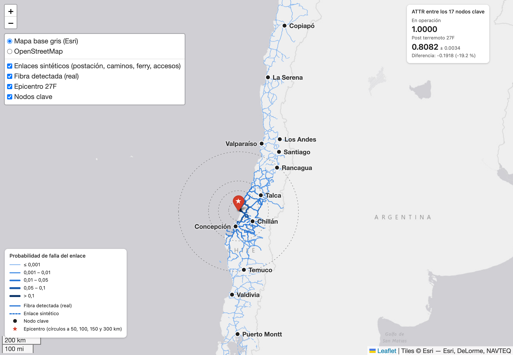
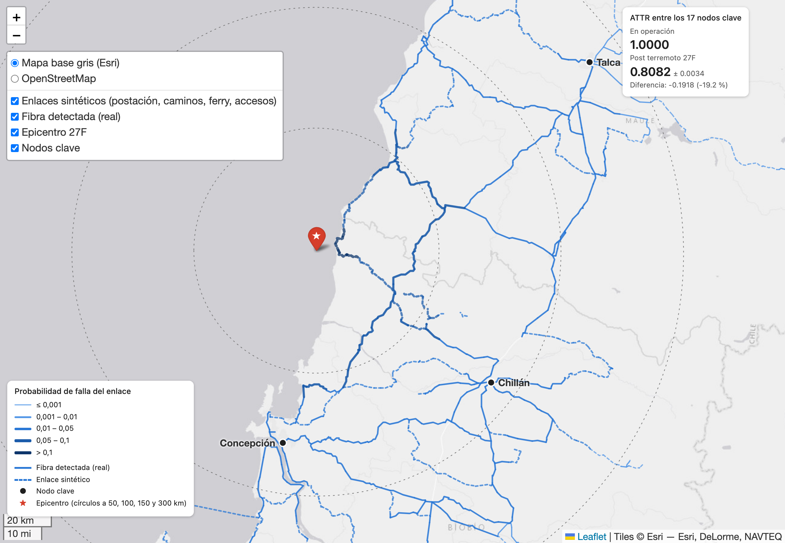

# ATTR — Resiliencia de la infraestructura de Internet chilena ante el terremoto 8.8 (27F)

Tarea 2 — CIT3435 Algoritmos de Ruteo y Redes Resilientes.

Se calcula el **ATTR** (*Average Two-Terminal Reliability*: confiabilidad promedio entre pares de nodos clave)
de la infraestructura de fibra óptica reportada en el *Estudio y Recomendaciones sobre la
Resiliencia de la infraestructura de la Internet chilena*, antes y después del terremoto
Mw 8.8 del 27-02-2010.

## Requisitos

- Docker + Docker Compose (base de datos PostgreSQL 17 + PostGIS 3.5 + pgRouting 3.7.3)
- Python 3.10+

## Ejecución (un solo comando)

Con Docker abierto, desde un clon limpio del repositorio:

```bash
git clone https://github.com/tleonn/ATTR.git
cd ATTR
python3 -m venv .venv
source .venv/bin/activate          # Windows: .venv\Scripts\activate
pip install -r requirements.txt

python main.py
```

`main.py` ejecuta todo el flujo:

1. Levanta la BD con `docker compose up -d --wait` (PostgreSQL 17 + PostGIS 3.5 + pgRouting 3.7.3).
2. Crea la base `attr` **vacía** y carga `main.sql` (infraestructura, nodos clave, topología y sismo).
3. Recalcula la **topología** con `pgr_nodeNetwork` + `pgr_createTopology` sobre las capas cargadas.
4. Calcula el **ATTR en operación** (`prob_falla = 0`).
5. Calcula la **probabilidad de falla de cada enlace** por el terremoto (`sql/02_prob_falla.sql`) y
   verifica que la topología y las probabilidades coinciden con las de `main.sql`.
6. Calcula el **ATTR post terremoto** y lo compara con el previo (nodos y enlaces más afectados).
7. Genera el **mapa Leaflet** en `output/mapa.html` y lo abre en el navegador.

Toma ~15 s y entrega los mismos valores de este informe (Monte Carlo con semilla fija):

```
ATTR en operación : 1.0000  (exacto)
ATTR post 27F     : 0.8082  ± 0.0034  (monte carlo, 20000 iteraciones)
Diferencia        : -0.1918  (-19.2 %)
```

| Opción | Efecto |
|--------|--------|
| `--desde-cero` | Reconstruye todo desde los shapefiles (carga, nodos clave, `pgr_createTopology`, sismo desde USGS) en vez de cargar `main.sql`. Entrega los mismos valores (~15 s). |
| `--sin-docker` | Usa una BD PostgreSQL ya levantada (con PostGIS y pgRouting 3.7), configurada con las variables `DB_*` o un archivo `.env`. |
| `--no-abrir` | No abre el navegador. |
| `--iteraciones N` | Cambia el número de iteraciones Monte Carlo (por defecto 20.000). |

La BD queda expuesta en `localhost:5433` (usuario/clave `postgres`/`postgres`, base `attr`).
Para cambiar estos valores, copiar `.env.example` a `.env`. El mapa necesita conexión a
Internet para cargar las teselas del mapa base.

## Etapas

### 1. Carga de la infraestructura

```bash
python scripts/cargar_infraestructura.py
```

Crea las extensiones `postgis` y `pgrouting` y carga cada shapefile (EPSG:4326) en su tabla:

| Tabla                  | Tramos | Longitud (km) |
|------------------------|-------:|--------------:|
| `fibra_optica`         |  1.915 |        10.313 |
| `camino_sin_postacion` |  1.165 |         8.108 |
| `postacion_electrica`  |  1.213 |         6.712 |
| `trayecto_ferry`       |    204 |         2.390 |
| **Total**              |  4.497 |    **27.523** |

Solo `fibra_optica` (10.313 km) es fibra detectada; las otras capas son rutas sin fibra.

### 2. Nodos clave

```bash
python scripts/cargar_nodos_clave.py
```

Carga `data/nodos_clave.csv` en la tabla `nodos_clave`, 17 nodos que **generan**
(aterrizajes de cables submarinos en Arica y Valparaíso, salida terrestre a Argentina por
Los Andes), **intercambian** (PITs y data centers de Santiago, anillos urbanos de Concepción y
Temuco) o **reciben** información (capitales regionales sobre la troncal). Criterio, fuentes
y ubicación en [`docs/nodos_clave.md`](docs/nodos_clave.md).

### 3. Topología

```bash
python scripts/topologia.py
```

Une las capas en EPSG:32719, corta las uniones en "T" con `pgr_nodeNetwork` y ejecuta
`pgr_createTopology('red', 10, 'geom', 'id')` (tolerancia de 10 m). El resultado es la tabla de
enlaces `red` (con `prob_falla = 0` por defecto) y la tabla de vértices `red_vertices_pgr`.
La fibra es la red real; la postación, los caminos, los ferrys, los accesos a nodos clave y un
puente de 2,6 km se marcan como **sintéticos**. Los 17 nodos clave quedan en la componente
principal (97,6 % de los vértices). Detalle, tolerancia y limitaciones en
[`docs/topologia.md`](docs/topologia.md).

### 4. ATTR en operación

```bash
python scripts/attr.py --escenario operacion
python tests/test_attr.py        # validación contra casos teóricos
```

ATTR = promedio, sobre los 136 pares de nodos clave, de la probabilidad de que queden
conectados. Se calcula de forma exacta cuando quedan pocos enlaces con 0 < p < 1, y por Monte
Carlo (20.000 iteraciones, cota de Hoeffding para un error de ±0,01 con 95 % de confianza) en
otro caso. **Con la infraestructura en operación, ATTR = 1,0000** (exacto): los 17 nodos
clave están conectados. Definición, referencias y método en [`docs/attr.md`](docs/attr.md).

### 5. Sismo 27F (USGS)

```bash
python scripts/cargar_sismo.py
```

Descarga el GeoJSON del sismo Mw 8.8 del 27-02-2010 desde la API FDSN de USGS (evento
`official20100227063411530_30`) y lo carga en la tabla `sismo`. Si no hay conexión, usar la
copia en `data/sismo_27F.geojson`. Epicentro: (−36,122; −72,898), profundidad 22,9 km.

### 6. Modelo de falla

```bash
python scripts/modelo_falla.py   # curva PGA y probabilidad de falla vs. distancia
```

Atenuación de PGA para subducción de **Youngs et al. (1997)** (SRL 68(1)), a partir de la
distancia al epicentro, más la fragilidad lognormal de **HAZUS** para circuitos de distribución
aéreos (Tabla 8-30). La probabilidad de falla de un enlace es la fracción esperada de circuitos
que fallan: ≈ 0,11 en el epicentro, 0,02 a 100 km y ≈ 0 sobre 300 km. Fórmulas, parámetros y
justificación en [`docs/sismo_modelo_falla.md`](docs/sismo_modelo_falla.md).

### 7. Probabilidad de falla por enlace

```bash
python scripts/prob_falla.py
```

`sql/02_prob_falla.sql` implementa el modelo como funciones SQL (`pga_youngs`, `fragilidad`,
`prob_falla_sismo`) y actualiza `red.prob_falla` usando `ST_Distance` entre cada enlace y el
epicentro. Resultado: p máx = 0,105 en la costa de Ñuble, cerca de
Cobquecura; 553 enlaces (~2.285 km) con p > 0,01 y 74 % de la red con p ≤ 0,0001. Enlaces
más y menos afectados en [`docs/prob_falla.md`](docs/prob_falla.md).

### 8. `main.sql`

```bash
python scripts/generar_main_sql.py
```

`main.sql` (6,7 MB) contiene todo lo necesario para reproducir el análisis sin los shapefiles:
las 4 capas de infraestructura, `nodos_clave`, la topología (`red` + `red_vertices_pgr`), la
tabla `sismo`, las funciones del modelo de falla y **`red.prob_falla` con las probabilidades
del 27F**. Usa `INSERT` (no `COPY`), así que carga con cualquier cliente:

```bash
createdb attr_nueva
psql -d attr_nueva -f main.sql
# o, con el contenedor del repositorio:
docker compose exec -T db psql -U postgres -c "CREATE DATABASE attr_nueva"
docker compose exec -T db psql -U postgres -d attr_nueva -f /dev/stdin < main.sql
```

Verificado en BDs vacías (con `psql` y con psycopg2): 5.323 enlaces, 4.583 vértices,
17 nodos clave, 1 sismo y Σ prob_falla = 18,7331, idénticos a la BD original. Para volver al
escenario en operación basta con `UPDATE red SET prob_falla = 0;`.

### 9. ATTR post terremoto

```bash
python scripts/attr.py --escenario terremoto
python scripts/comparar_attr.py
```

| Escenario | ATTR |
|-----------|-----:|
| En operación | 1,0000 (exacto) |
| Post 27F | **0,8082 ± 0,0034** (Monte Carlo, 20.000 iteraciones) |
| Diferencia | **−0,1918 (−19,2 %)** |

El cuello de botella es el corredor Talca–Chillán (R = 0,67), que separa el bloque norte-centro
del sur. Concepción (−26,1 %) y Chillán (−24,2 %) son los nodos más afectados, lo que coincide
con las regiones VII y VIII del 27F. Comparación con la bibliografía (TCLEE 2010; Estudio NIC
Chile) y limitaciones en [`docs/attr_terremoto.md`](docs/attr_terremoto.md).

### 10. `main.py` y mapa Leaflet

`main.py` orquesta todas las etapas anteriores (ver *Ejecución*) y `scripts/mapa.py` genera
el mapa con folium (Leaflet):

- **Enlaces** coloreados por probabilidad de falla en 5 clases de una escala secuencial de azul
  (más oscuro y más grueso = más probable que falle).
- **Fibra detectada** en trazo continuo y **enlaces sintéticos** (postación, caminos, ferry,
  accesos, puente) en trazo **punteado**, cada uno en una capa que se puede activar o desactivar.
- **Nodos clave** con etiqueta; al hacer clic muestran su tipo, rol y confiabilidad promedio
  antes y después del terremoto.
- **Epicentro** del 27F con círculos a 50, 100, 150 y 300 km.
- Panel con el **ATTR antes y después**, y tooltip con p, PGA y distancia al epicentro de cada
  enlace.





## Estructura

```
.
├── data/
│   ├── nodos_clave.csv
│   ├── sismo_27F.geojson
│   └── infraestructura/
│       ├── fibra_optica_detectada.*
│       ├── camino_sin_postacion_detectado.*
│       ├── postacion_electrica_detectada.*
│       └── trayecto_en_ferry.*
├── docs/
│   ├── img/                        # capturas del mapa
│   ├── attr.md
│   ├── attr_terremoto.md
│   ├── nodos_clave.md
│   ├── prob_falla.md
│   ├── sismo_modelo_falla.md
│   └── topologia.md
├── scripts/
│   ├── db.py                       # conexión a la BD
│   ├── cargar_infraestructura.py   # shapefiles -> PostGIS
│   ├── cargar_nodos_clave.py       # nodos clave -> PostGIS
│   ├── topologia.py                # pgr_nodeNetwork + pgr_createTopology
│   ├── attr.py                     # ATTR exacto / Monte Carlo
│   ├── comparar_attr.py            # antes vs después, nodos y enlaces críticos
│   ├── mapa.py                     # mapa Leaflet (folium)
│   ├── cargar_sismo.py             # GeoJSON USGS -> tabla sismo
│   ├── modelo_falla.py             # Youngs (1997) + fragilidad HAZUS
│   ├── prob_falla.py               # probabilidad de falla por enlace
│   └── generar_main_sql.py         # pg_dump -> main.sql
├── sql/
│   ├── 00_extensiones.sql
│   ├── 01_topologia.sql
│   └── 02_prob_falla.sql
├── tests/
│   └── test_attr.py
├── main.py                         # flujo completo con un solo comando
├── main.sql                        # BD completa con probabilidades de falla
├── docker-compose.yml
├── requirements.txt
└── README.md
```

## Dependencias

| Librería          | Uso                                                   |
|-------------------|-------------------------------------------------------|
| `psycopg2-binary` | Conexión a PostgreSQL/PostGIS                         |
| `folium`          | Generación del mapa Leaflet (incluye `branca` para la leyenda) |
| `requests`        | Descarga del GeoJSON del sismo desde USGS             |
| `numpy`           | Simulación Monte Carlo del ATTR                       |
| `python-dotenv`   | Lectura opcional de credenciales desde `.env`         |
| `pyshp`           | Lectura de shapefiles (la imagen no trae `shp2pgsql`) |
| `scipy`           | Componentes conexas (`csgraph`) en el cálculo del ATTR |
